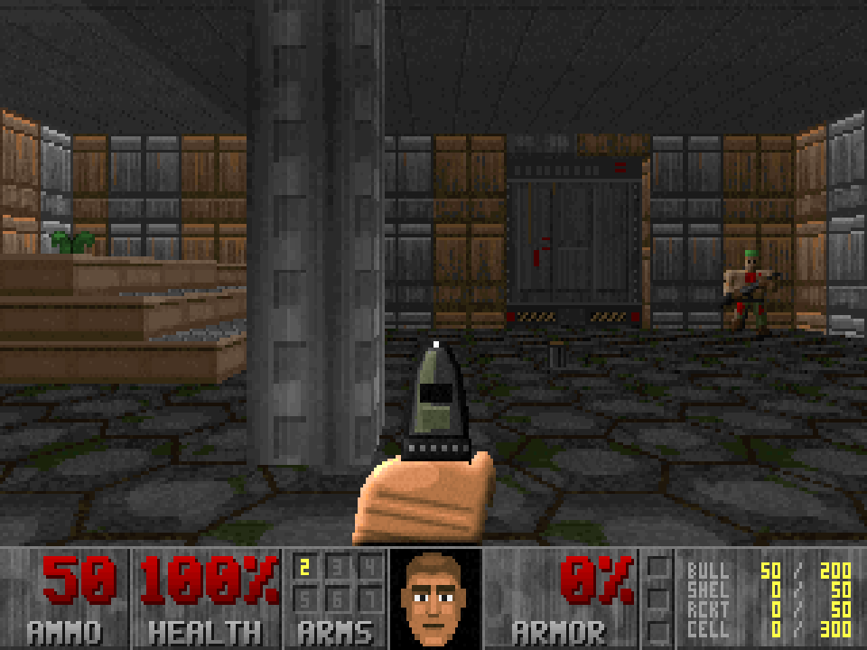

# Doom-lite

A single-page first-person shooter in the style of Doom's first level.
Open `index.html` in a browser. It needs no other file and no network.

JavaScript generates every texture, sprite, and sound when the page loads.

Controls: arrows move and turn, Ctrl fires, Space opens doors, Shift runs,
Alt+arrows or `,` and `.` strafe.

Cheat code: type `runbabyrun` to watch a recorded run that kills every
monster, collects every item, and uses the exit switch.

Not affiliated with id Software. DOOM is a trademark of id Software.
Code license: GPL-2.0.
